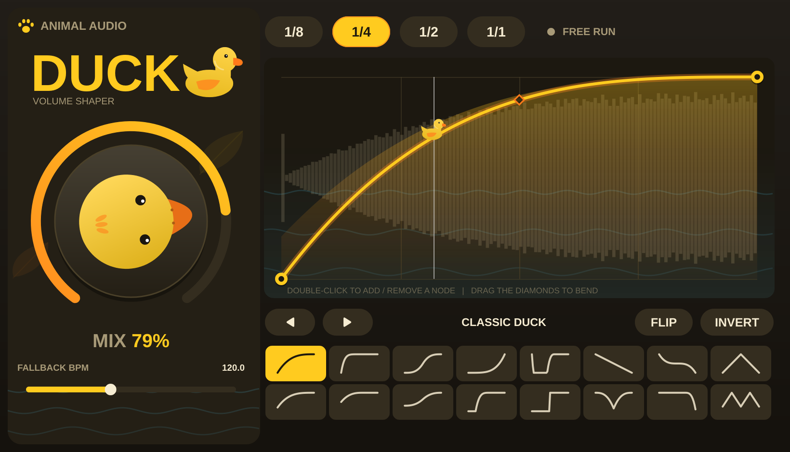
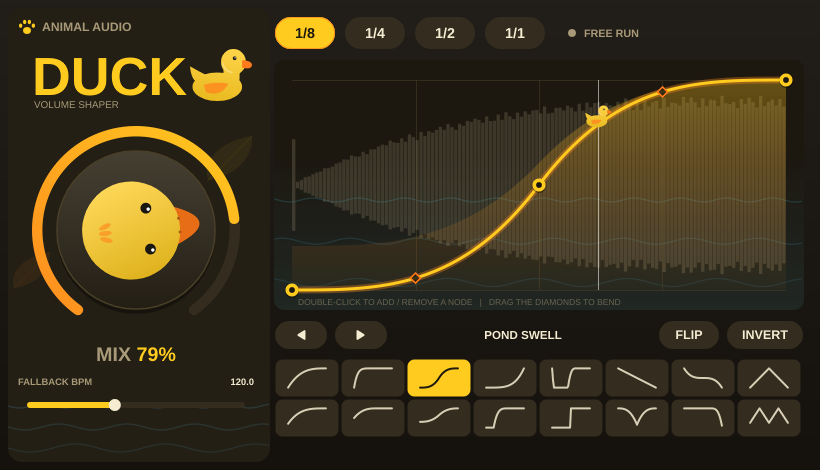
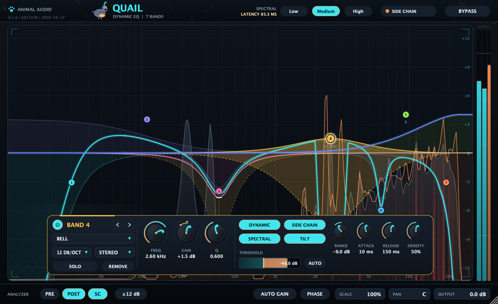
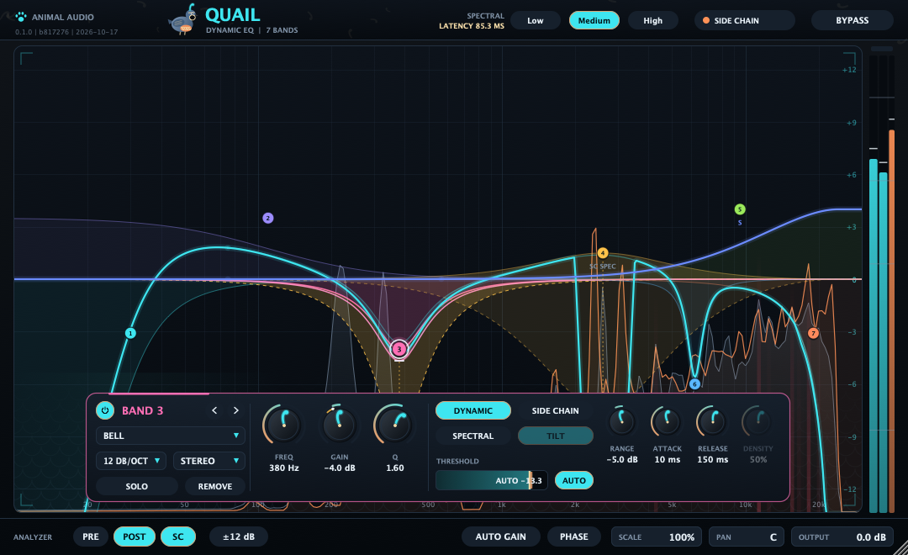

<h1 align="center">Animal Audio</h1>
<p align="center"><b>A series of VST3 plugins with juice, for Ableton Live and any other VST3 host.</b></p>

<p align="center">
  
</p>

Every plugin in the series is built from the same toolbox: JUCE + CMake, shared DSP/UI libraries,
realtime-safe processing, and a bold, playful look with a bit of animal personality.

## Get started

**Use plugins in Ableton (or any VST3 host):**

1. `git clone https://github.com/SammyEl-Sherif/ableton.git && cd ableton`
2. Run **`/setup`** in Cursor or Claude Code, or by hand:
   `python3 scripts/install_plugins.py --build --clean` (`--prereqs` first; `--dry-run` to preview).
3. In **Ableton Live → Preferences → Plug-ins**, enable **Use VST3 Plug-In System Folders** and **Rescan**
   (hold **Alt** / **Option** for a full rescan if needed).
4. Add a plugin from **Plug-Ins → VST3 → Animal Audio** on an audio track. Confirm the **build stamp**
   (hover the ANIMAL AUDIO badge) matches what the install script printed.

Details: [Install](#install) and `.cursor/skills/setup/SKILL.md`.

**Create a new plugin in the series** — animal-themed design (palette, Motif, BrandBadge), shared DSP/widgets as needed:

```bash
# In Cursor or Claude Code, e.g. /vst Otter — tempo-synced stereo wobbler
python3 scripts/new_plugin.py Wobble --description "One-line description"
scripts/verify_plugin.sh Wobble
```

The **`/vst`** skill (`.cursor/skills/vst/SKILL.md`) walks through scaffold, Theme/Motif, DRY extraction to
`shared/`, building **all** plugins, fixing build errors, tests, and docs. More detail: [Adding a plugin](#adding-a-plugin)
and [AGENTS.md](AGENTS.md).

| Skill | When to use |
| --- | --- |
| **`/setup`** | New dev or tester: clone, build, install VST3s, rescan in Ableton |
| **`/vst`** | New Animal Audio effect: animal-themed UI + shared libraries (layout is up to the concept) |

## The series

<!-- PLUGINS:START -->
| Plugin | What it does | Source | Status |
| --- | --- | --- | --- |
| **Duck** | Tempo-synced volume ducking with a draggable curve editor, 16 preset shapes and a big MIX knob | `plugins/duck` | Alpha: builds as VST3, all tests pass, passes pluginval level 10 on Linux; not yet tried in a real DAW |
| **Quail** | 24-band dynamic EQ: 10 shapes up to 96 dB/oct, stereo/mid/side placement, side-chain and spectral (per-frequency) dynamics, pre/post/side-chain analyser | `plugins/quail` | Alpha: builds as VST3 on macOS, all its tests pass, passes pluginval level 10 on macOS; not yet tried in a real DAW |
<!-- PLUGINS:END -->

More animals are on the way. Adding one takes a single command (or the `/vst` agent skill), see [Adding a plugin](#adding-a-plugin).

## Duck

A volume shaper in the spirit of the classic sidechain-free "kick ducking" tools: it dips your signal
on every beat and lets it swim back up along a curve you draw. No sidechain routing, no kick needed.

- **Time divisions** `1/8`, `1/4`, `1/2`, `1/1`: one duck per note division, locked to the host's
  playhead (PPQ) and tempo.
- **Free-run fallback**: when the transport is stopped, or a host reports no position, Duck keeps
  going at the host BPM (or the *Fallback BPM* slider) so you can always hear what you are drawing.
  The status pill shows `HOST SYNC` or `FREE RUN`.
- **MIX** (the big rubber-duck knob): dry/wet of the *ducking effect*. 0% is a bit-exact bypass,
  100% applies the full curve.
- **Editable curve**: drag nodes, drag the diamond handles to bend a segment, double-click to add
  or remove nodes (up to 16). `FLIP` mirrors the curve in time, `INVERT` turns it upside down.
- **16 preset shapes** in two rows, plus prev/next buttons. A rubber duck rides the curve at the
  playhead, and the post-duck signal level is drawn behind it.
- **Click-free**: all gain changes (including hard-edged curves, mix and curve edits) go through
  a ~0.7 ms declick smoother. The audio thread never allocates, locks or does I/O.
- **State**: parameters and the curve are saved with your Live set / preset (APVTS ValueTree).

<p align="center">
  
</p>

> Both screenshots are rendered by the UI code itself, headlessly, in the test suite
> (`AA_SCREENSHOT_DIR=docs/images ./build/plugins/duck/DuckTests "duck: editor renders headlessly"`).

## Quail

A precise, fast 24-band EQ that also listens: any band can turn itself down (or up) when its own signal or
**another track** gets loud, either as a whole band or **frequency by frequency**. Make room for the vocal in
the guitars only where and when the vocal sings.

<p align="center">
  
</p>

- **24 bands, 10 shapes**: Bell, Low/High Shelf, Low/High Cut, Notch, Band Pass, Tilt Shelf, Flat Tilt and
  All Pass, with slopes from 6 to 96 dB/oct; 10 Hz–30 kHz, ±30 dB, Q 0.025–40.
- **Stereo placement** per band: Stereo, Left, Right, Mid or Side (the node shows `L`/`R`/`M`/`S`).
- **Dynamic EQ**: switch on `DYNAMIC` and a band moves within its **RANGE** (±30 dB; drag the diamond under
  the node) as its trigger crosses the **THRESHOLD**, set by hand or `AUTO` (follows the trigger's
  average level). Attack 0.5–500 ms, release 5 ms–5 s. Cuts and boosts both work.
- **Side chain**: `SIDE CHAIN` makes a band listen to Quail's side-chain input instead of its own band.
  Duck the low end under the kick, dip the guitars' presence range while the vocal sings, or lift a
  band when another part plays (positive range). In Live, pick the source track in the device's side-chain
  (Audio From) section; the top bar shows whether a side chain is connected.
- **Spectral dynamics**: `SPECTRAL` (bells and shelves) runs the band per FFT bin, so only the frequencies
  where the trigger is loud move: a side-chained spectral band follows the vocal's harmonics as they change.
  `DENSITY` smooths the trigger across frequency (0% = every bin on its own, 100% = the whole band
  together); `TILT` adds 3 dB/oct to the trigger around 1 kHz so highs trigger as readily as lows.
  `LOW`/`MEDIUM`/`HIGH` resolution trades frequency detail for latency (MEDIUM: 4096 samples, 85 ms at
  48 kHz), which is reported to the host only while a spectral band is active. Without one, Quail adds
  zero latency.
- **Analyser**: `PRE`, `POST` and `SC` spectra; with the side chain shown, red columns mark **collisions**,
  where your track and the side chain are both loud at the same frequency. Display range ±3/6/12/30 dB.
- **Fast editing**: double-click to add a band (it becomes a cut near either end), drag nodes (Shift fine,
  Alt for Q), scroll for Q, lasso and drag several bands at once, right-click for shape and placement menus,
  double-click or Delete to remove. The floating panel follows the selected band; hold `SOLO` to hear just it.
- **Output**: level, pan, phase invert, `AUTO GAIN` (keeps loudness about constant while you EQ) and
  `SCALE` (0–200% of every band's gain).
- **Clean**: an empty or flat EQ is a bit-exact pass-through, also after automation returns to flat; changes
  of shape, slope or placement crossfade, every value glides, and the result does not depend on the buffer
  size. Bypass is a soft crossfade to the latency-compensated dry signal.
- **State**: all 439 parameters are automatable and saved with the set, along with the analyser options and
  the window size (the editor is resizable).

<p align="center">
  
</p>

> Rendered headlessly by `AA_SCREENSHOT_DIR=docs/images ./build/plugins/quail/QuailTests "quail: editor: renders*"`.

## Build

Requirements: CMake 3.22+, a C++17 compiler, and Ninja (optional, recommended). JUCE and Catch2 are
downloaded by CMake at configure time (pinned in `cmake/FetchDependencies.cmake`).

**Linux** (Debian/Ubuntu)

```bash
sudo apt-get install ninja-build libasound2-dev libfreetype-dev libfontconfig1-dev libx11-dev \
  libxrandr-dev libxinerama-dev libxcursor-dev libxext-dev libgl1-mesa-dev libcurl4-openssl-dev
cmake -S . -B build -G Ninja -DCMAKE_BUILD_TYPE=Release
cmake --build build --parallel
ctest --test-dir build --output-on-failure
```

**macOS**: Xcode command line tools, then the same commands (`brew install ninja` if you like Ninja).

**Windows**: Visual Studio 2022 with the C++ workload, then from a Developer PowerShell:

```powershell
cmake -S . -B build
cmake --build build --config Release --parallel
ctest --test-dir build -C Release --output-on-failure
```

Build just one plugin: `cmake --build build --target Duck_VST3`. Restrict what is configured with
`-DAA_PLUGINS=duck`.

## Install

`python3 scripts/install_plugins.py` (or the `/setup` skill) installs every built bundle
(`build/plugins/<name>/<Name>_artefacts/Release/VST3/<Name>.vst3`) for you:

| OS | Default VST3 folder | Machine-wide (`--system`, needs admin) |
| --- | --- | --- |
| macOS | `~/Library/Audio/Plug-Ins/VST3/` | `/Library/Audio/Plug-Ins/VST3/` |
| Windows | `%COMMONPROGRAMFILES%\VST3` when run as administrator, else `%LOCALAPPDATA%\Programs\Common\VST3` | `%COMMONPROGRAMFILES%\VST3` |
| Linux | `~/.vst3/` | `/usr/lib/vst3/` |

It overwrites the old copy, removes stale copies from the other folders, and on macOS clears quarantine and
ad-hoc signs the bundle. `--list` shows every installed copy with its build stamp, `--uninstall` removes them,
`--dry-run` previews. Alternatively configure with `-DAA_COPY_PLUGINS_AFTER_BUILD=ON` (`scripts/configure.sh` on
macOS) to have each build copy its bundle. Duck and Quail are audio effects: drop them on any audio track.

**Installing a CI build instead:** every CI run uploads `animal-audio-vst3-<OS>` (Actions > the run > Artifacts).
They are unsigned: on macOS run `xattr -dr com.apple.quarantine <Plugin>.vst3` and
`codesign --force --deep --sign - <Plugin>.vst3` after unzipping, and note the macOS CI build is arm64 only
(Intel/Rosetta Live needs a local `--universal` build). Copy the bundle to the folder above.

### Ableton loads an old build?

1. `python3 scripts/install_plugins.py --list`: it lists every installed copy and flags builds from another commit.
   The same plugin in two folders (e.g. user and system) is the classic cause: the install script removes the stale one.
2. Rebuild from the commit you want: `git pull && python3 scripts/install_plugins.py --build --clean`.
3. In Live, **Rescan** (Alt/Option for a full rescan), or quit and reopen Live; remove and re-add the device on tracks
   that still use the old one.
4. Hover the ANIMAL AUDIO badge in the plugin UI: the build stamp must show the new SHA/date. `+dirty` means it was
   built from a working tree with uncommitted changes.

## Release zips (animal.audio downloads)

Mac builds for the website must be **Developer ID signed and notarized** before upload.

1. Complete [docs/APPLE_DEVELOPER_SETUP.md](docs/APPLE_DEVELOPER_SETUP.md).
2. Run `./scripts/release_mac_duck.sh` → `dist/releases/<version>/Duck-<version>-mac-vst3.zip`.
3. Windows: `.\scripts\package_win_duck.ps1` after a Release build.

Upload paths and Supabase steps live in the **animal-audio-web** repo: `docs/DOWNLOADS_LAUNCH.md`.

## Repository layout

```
CMakeLists.txt          top level: fetches JUCE/Catch2, adds shared/ and every plugins/*
cmake/                  FetchDependencies.cmake, AnimalAudioPlugin.cmake (aa_add_plugin)
shared/dsp/             animalaudio::dsp  header-only C++17 DSP (smoothing, tempo sync, curves, gain engine, filter design,
                        EQ bands, envelope follower, FFT, STFT, analyser) + tests
shared/core/            animalaudio::core plugin processor base (params, state, optional side chain), curve state, shaper processor
shared/ui/              animalaudio::ui   Theme (palette + animal motif), themed panels, the shaper editor and its widgets
shared/testing/         animalaudio::testing  standard test suites every shaper plugin runs, native-window mouse helpers
plugins/<name>/         one folder per plugin: only what is specific to it (presets, theme/motif, own DSP)
templates/plugin/       starter used by scripts/new_plugin.py
.cursor/skills/        the /vst and /setup skills (mirrored to .claude/skills/)
scripts/                new_plugin.py, install_plugins.py (+ tests/), verify_plugin.sh, format.sh, sync_skills.sh, check_repo.sh
docs/images/            README screenshots
AGENTS.md               guide for AI agents and contributors (CLAUDE.md and .cursor/rules point here)
```

## Adding a plugin

**With an agent:** run the `/vst` skill (Cursor: type `/vst Otter, a tempo-synced stereo wobbler`; Claude Code
reads the same skill from `.claude/skills/vst`). It scaffolds, implements DSP and an animal-themed UI, adds
tests, builds, runs ctest and pluginval, updates this README and AGENTS.md, and opens a PR.

**By hand:**

```bash
python3 scripts/new_plugin.py Wobble --description "Tempo-synced stereo wobbler"
cmake -S . -B build
scripts/verify_plugin.sh Wobble        # build, ctest, screenshots, pluginval
```

You get a **scaffold** that builds (curve shaper + `ShaperEditor`, like Duck)—a starting point, not a layout
requirement. **`/vst`** should reshape UI and DSP for the concept while keeping **Animal Audio** identity: own
hue and palette (`makePaletteFromHue()`), a `Motif` (Path-drawn animal art), and `BrandBadge`. Compose any
layout from shared widgets or a custom editor in `Source/ui/`.

Code is shared, not copied: everything generic lives in `shared/` (`dsp`, `core`, `ui`, `testing`), and the
rule is that the second use of anything moves it there. A plugin folder holds only presets, theme/motif and
its own DSP. See [AGENTS.md](AGENTS.md) for the policy, conventions and realtime-safety rules.

## Status and caveats

- Duck has been built as a real VST3 and exercised by unit/integration tests (DSP, tempo math, state
  round-trip, mouse editing, headless UI render, real synthetic mouse events through a native window at several UI scales) on Linux. The Linux VST3 also passes pluginval at strictness 10. It has not yet been loaded in Ableton Live
  or validated with Steinberg's own `validator`; macOS and Windows builds are configured in CI but
  unverified until the first workflow run.
- Quail was built and tested on macOS (arm64). Covered: drawn versus measured response for every shape;
  side-chain and spectral ducking through the real side-chain bus; stereo placement; click-free changes;
  block-size independence; latency reporting and bypass compensation; state; mouse editing; headless UI
  render; pluginval at strictness 10. Its real-mouse test (native window, several UI scales) needs an unlocked
  display: it was skipped on the Mac it was built on and is left to CI (Linux, Xvfb). It has not yet been
  loaded in Ableton Live; Linux/Windows rely on CI.
- The repository has no open-source license yet (see [LICENSE](LICENSE)). JUCE and the VST3 SDK are
  AGPL/GPL or commercially licensed, so decide on licensing before distributing binaries.
- Duck is an original design inspired by the general idea of volume-shaper ducking tools; Quail by the
  workflow of modern dynamic and spectral EQs. Neither uses any third-party branding, names or assets.

<p align="center"><sub>Animal Audio</sub></p>
